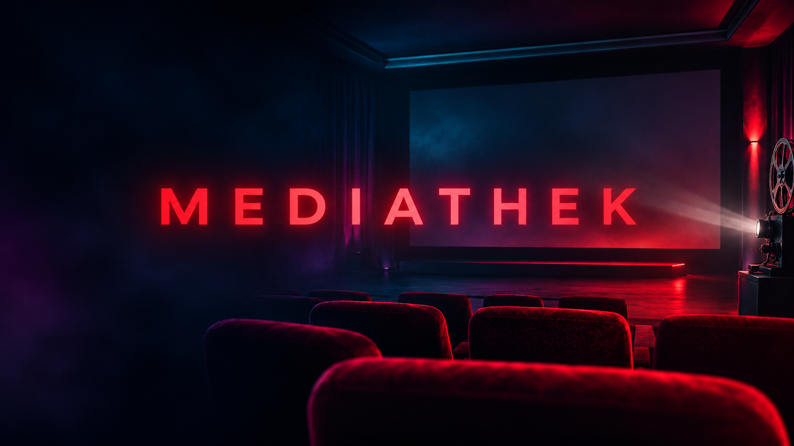
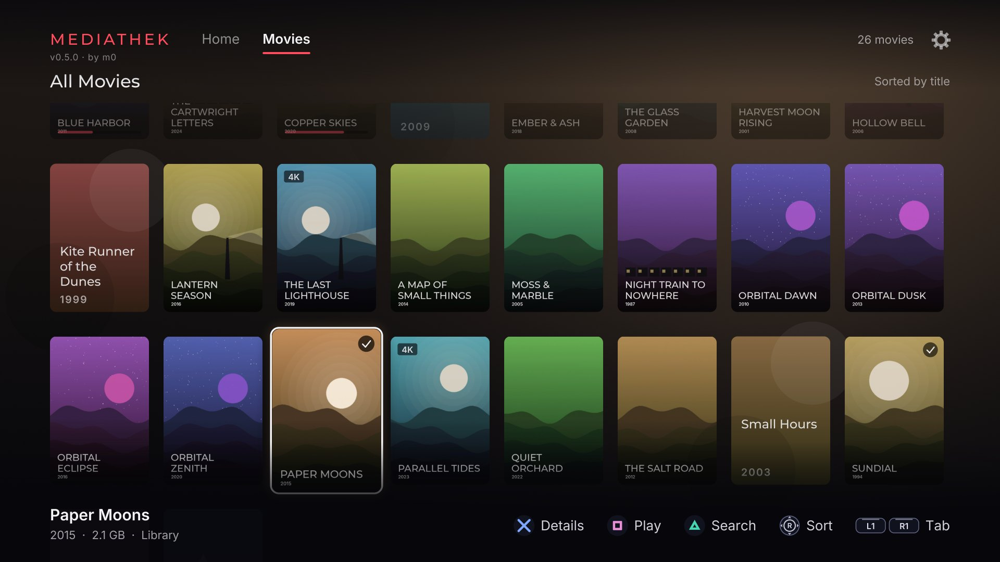
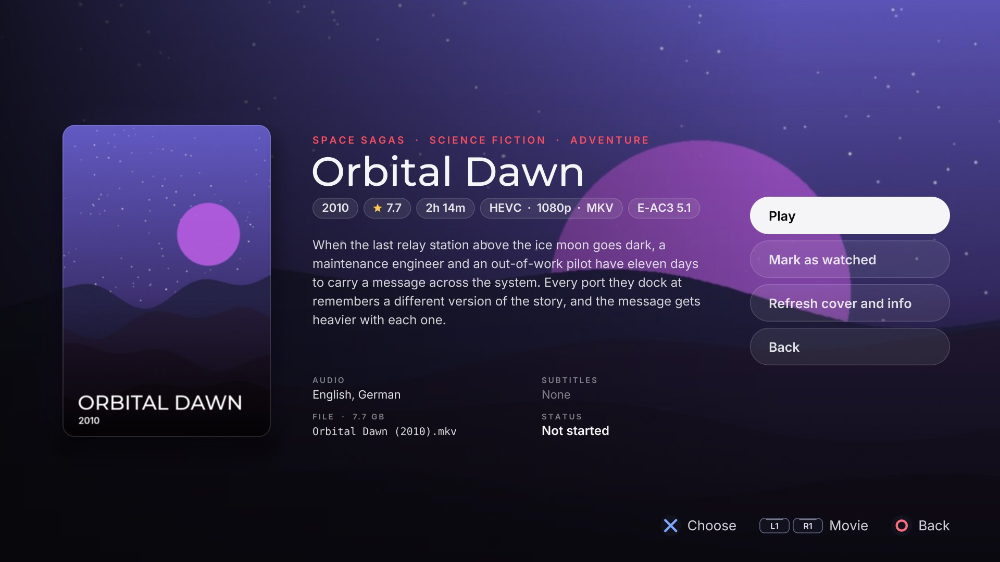
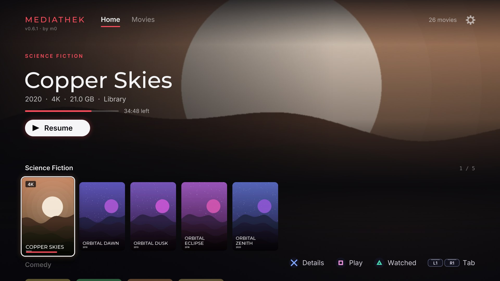
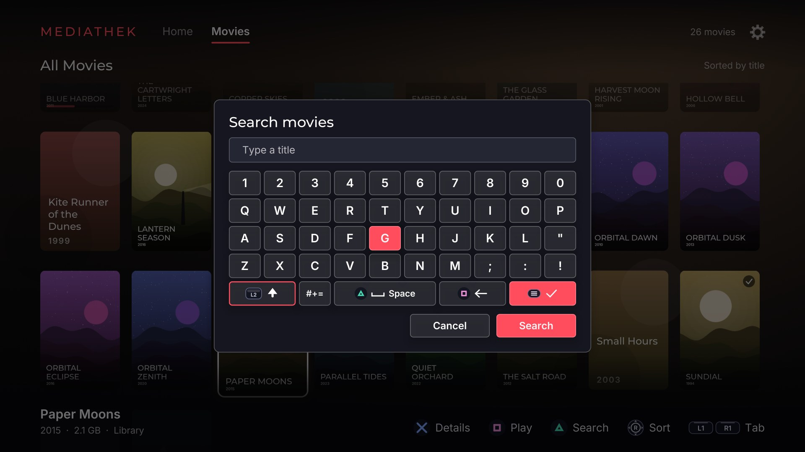
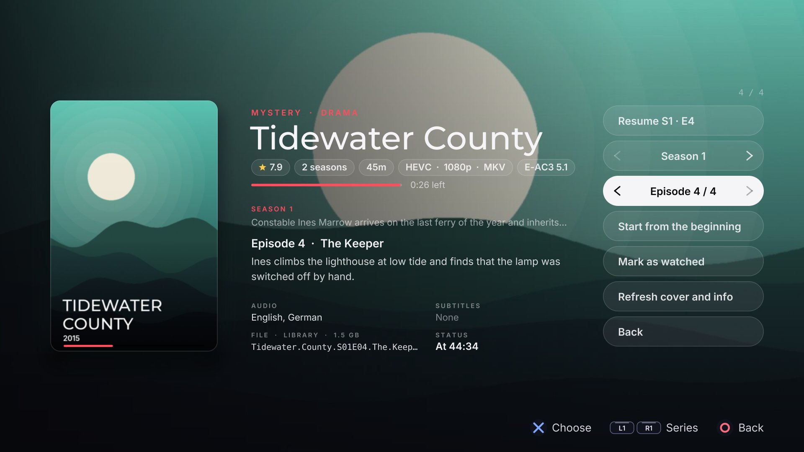
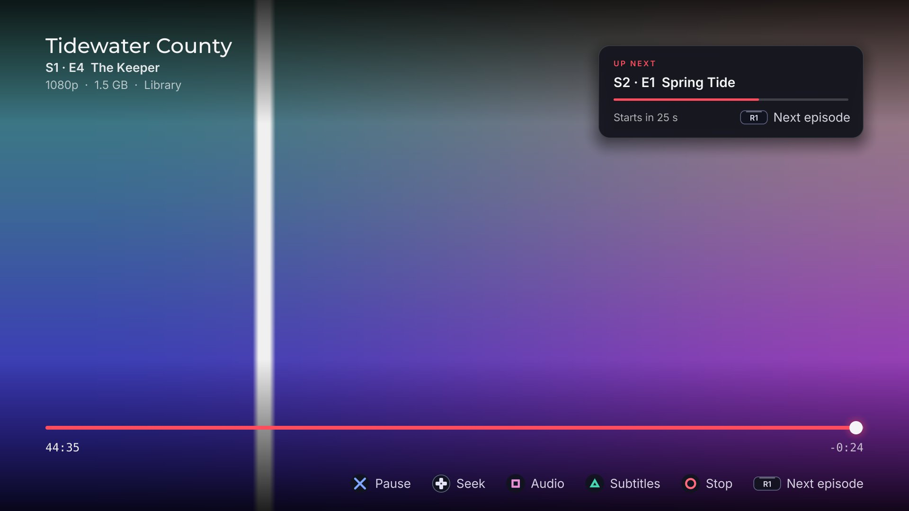
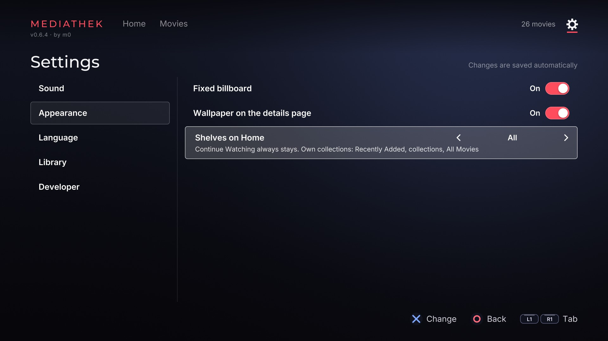
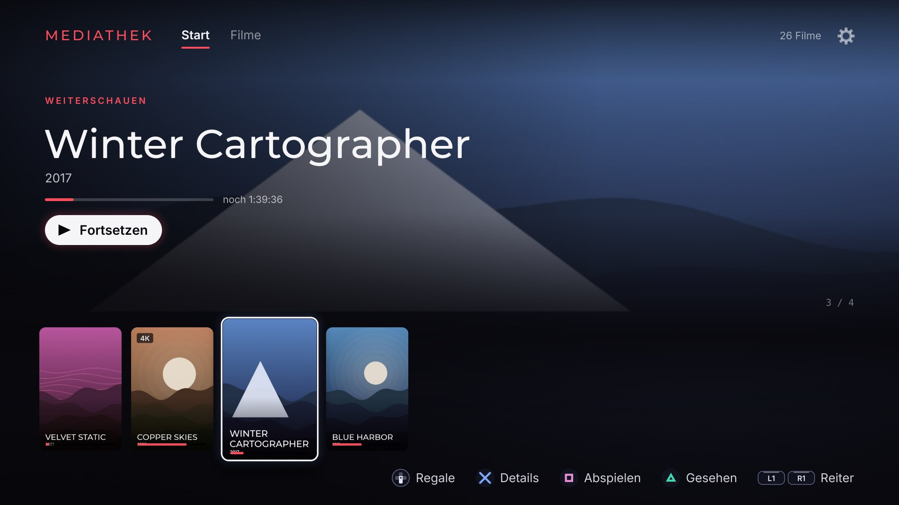

<p align="center"></p>

<div align="center">

---

**A Netflix-style library for your movies and series on PS5.**<br>
Put your films in a `movies` folder and your series in `tvshows`. Mediathek finds them, fetches their posters and plays them.

[](CHANGELOG.md)
[](#what-you-need)
[](#status)
[](#settings-and-language)
[](LICENSE)
[](https://github.com/M0S4YSH3LL0/mediathek-ps5/releases)

[](https://prosperostore.net/app/PPSA66120/)
[](https://recompstore.com/game/PPSA66120)

[Install](#install) · [Your files](#your-files) · [Formats](#formats) · [Covers](#covers-and-descriptions) · [Controls](#controls) · [Screenshots](#screenshots) · [FAQ](#faq) · [Build](#build-from-source)

</div>


## Features

- **Finds your films** on the internal drive, USB and extended storage, and reads
  messy names: `blue.harbor.2011.2160p.BluRay.x265-GRP.mkv` is *Blue Harbor (2011)*.
- **Home:** a billboard, then shelves for *Continue Watching*, *Recently Added*,
  collections, genres and decades. A setting limits them to your own collections,
  genres or decades.
- **Movies:** a grid with search and sorting.
- **Series:** a tab of their own, and on Home among the films: in *Continue Watching* with
  the episode up next, and on the genre shelves. The details page chooses the season and
  the episode and shows the description of both. In the player, R1 starts the next
  episode, and in an episode's last 40 seconds a card counts down to it.
- **Details:** length, video and sound format, audio and subtitle languages, and
  Play, Resume or Start over.
- **Covers:** posters, wallpapers, descriptions, scores and genres from TMDB with a
  free key, generated covers without one. Your own pictures always win.
- **Player:** seeking that speeds up while you hold, audio and subtitle switching, a
  stream info panel. It remembers where you stopped; 92% counts as watched.

## What you need

- A PS5 that runs homebrew, with a loader that starts apps from `/data/homebrew`.
- An **ELF loader on `127.0.0.1:9021`** (etaHEN and compatible loaders have one).
  Without it the app starts but finds no films.
- For covers: a free [TMDB key](https://www.themoviedb.org/settings/api) and a network
  connection.

Setting up the console is not covered here. Your loader's documentation does that.

## Install

**From a store (recommended).** Mediathek is listed on two homebrew stores; install and
update it from either one's client on your console.

- [ProsperoStore](https://prosperostore.net/app/PPSA66120/), with its
  [client](https://github.com/darkxex/ProsperoStore/releases).
- [RecompStore](https://recompstore.com/game/PPSA66120).

**By hand.**

1. Download `Mediathek-PPSA66120-<version>.zip` from [Releases](../../releases), check
   it against its `.sha256` and unpack it.
2. Copy the `PPSA66120` folder to `/data/homebrew/`, so that
   `/data/homebrew/PPSA66120/eboot.bin` exists.
3. Wait about ten seconds. The console registers the title once the folder stops
   changing, and Mediathek appears on the home screen.
4. Start it. The first scan takes a moment; after that the library opens at once.

To update by hand, copy the new folder over the old one. If you then see an old icon
or the app will not start, delete `/data/homebrew/PPSA66120`, `/user/app/PPSA66120`
and `/user/appmeta/PPSA66120`, and copy it again.

## Your files

Put films anywhere below a `movies` or `mediathek/movies` folder (`Movies` works too), up to
six levels deep:

```
/data/movies/Blue Harbor (2011)/Blue Harbor (2011).mkv
/mnt/usb0/mediathek/movies/Space Sagas/Orbital Dawn (2010).mkv
```

It searches `movies` and `mediathek/movies`, and the [series folders](#series), on `/data`,
`/`, `/mnt/usb0-7` and `/mnt/ext0-1`. Press **Options** to scan again.

Films or series somewhere else? Add the folder in **Settings > Library > Add folder**: a full
path such as `/mnt/usb0/Media`, or just a name such as `Media`, which is then looked for on
every drive. Up to eight. Left and right on a folder choose what it holds:

- **Automatic** (the default): a `series`, `Serien`, `tvshows` or `TV Shows` folder anywhere
  inside it holds series, one folder per series; a file with an episode mark is an episode;
  everything else is a film.
- **Movies:** every video in it is a film, episode marks or not.
- **Series:** every video in it is an episode, and the first folder below it is the series,
  as in `tvshows`.

Choose a folder to remove it. Cross on the "No media found" screen goes straight there.

- **Collections:** a subfolder with two or more films becomes its own shelf.
- **Pictures:** `<film>-poster.jpg` and `<film>-fanart.jpg` beside the film. A film
  alone in its folder can also use `poster.jpg`, `folder.jpg` or `cover.jpg`, and
  `fanart.jpg` or `backdrop.jpg`.
- **Subtitles:** the tracks inside the film (text: SubRip, ASS, mov_text, WebVTT;
  pictures: PGS, VobSub, DVB), and `.srt` files named after the film, beside it or in a
  `subs` folder (a film alone in its folder owns all of `subs`; up to eight). A file's
  language comes from the name (`Film.de.srt`, `English.srt`) or else from the words
  inside. A film starts without subtitles unless *Force subtitles* is on; Triangle
  switches them on and steps through them all, the preferred language first, and in it
  the film's own tracks before the files. Its message says which: "German · embedded",
  "German · SRT", "English · SDH · embedded".
- **Forced subtitles:** a forced track holds only the lines in another language than the
  film's: a sign, a scene abroad. While no full subtitles are on, it shows by itself, in the
  *Subtitle language*, or with None in the language of the sound track playing (it follows
  Square). The film's own forced track comes before a file (`Film.de.forced.srt`). Triangle
  does not offer forced tracks: switching full subtitles off brings them back.
- **Audio language:** if a file does not say, its name can: `Film (2011) German DL.mkv`
  is listed as German.

### Series

Put series in a `tvshows` or `series` folder (also `TV Shows`, `mediathek/tvshows` and
`mediathek/series`), one folder per series, with season folders inside or not:

```
/data/tvshows/Tidewater County/Season 1/Tidewater.County.S01E01.mkv
/mnt/usb0/series/Starfall Station/season2/Starfall Station - 2x03 - Ballast.mkv
```

- **Episodes:** the name gives the season and the episode: `S01E02`, `s1e2`, `1x02` or
  `S01 E02`. Without one, a season folder (`Season 1`, `Season1`, `season 01`, `Staffel 1`,
  `S01`, `Specials`) gives the season and a number in the name (`E05`, `Episode 5`,
  `05 - Title`) the episode.
- **Anywhere else:** a file whose name has such a mark is an episode in any searched folder,
  of the series its folder is named after (or the name before the mark).
- **Pictures:** `poster.jpg` and `fanart.jpg` in the series' folder.
- **Watched:** Triangle on Home marks a whole series watched, or unwatched again; an episode
  is marked on its own on the details page.

## Formats

| | |
| --- | --- |
| **Files** | `.mkv` `.mp4` `.m4v` `.mov` `.avi` `.wmv` `.ts` `.m2ts` `.mpg` `.mpeg` `.webm` `.flv` `.vob` `.ogv` |
| **Video** | H.264, HEVC, VP9, VP8, MPEG-4 (Xvid, DivX), MPEG-2, MPEG-1, VC-1, WMV |
| **Audio** | AAC, AC-3, E-AC-3, TrueHD, DTS, MP2, MP3, Opus, Vorbis, FLAC, ALAC, WMA, PCM |
| **Subtitles** | Inside the film: SubRip, ASS/SSA (as plain text), mov_text, WebVTT, PGS, VobSub, DVB. Beside it: `.srt`. |
| **Pictures** | `.jpg` `.jpeg` `.png` |

H.264 (up to High) and HEVC (Main and Main10) films of any size up to 3840 x 2176 go to
the console's hardware decoder; FFmpeg decodes everything else on the CPU, and takes over
a film the hardware refuses or gives up on. HDR films (HDR10 and HLG) reach a TV the console
already sends HDR to as HDR10 (PQ, BT.2020), the menus and controls drawn over them at their usual
brightness; on an ordinary screen, or with *HDR output* off, they are tone-mapped to SDR. Both work
on either decoder, as long as the software-decoded films are 8- or 10-bit 4:2:0, which is what HDR
films are. The console's own HDR setting decides whether the TV gets HDR at all.

- **Plays smoothly on the hardware decoder:** H.264 and HEVC at every size: 4K HEVC, HDR
  included, and 1080p H.264 and 10-bit HEVC, smaller films and interlaced recordings.
- **Do not expect smooth playback:** 4K films the hardware decoder will not take (VP9,
  4:2:2, 12-bit, wider than 3840).
- **Does not play:** AV1, at any size. The build has no software decoder for it, and the
  console's hardware decoder is not known to take it.

A file with a codec the app cannot decode is still listed, but will not play. Audio
tracks it cannot decode are left out of the list.

## Covers and descriptions

1. Get a free key at [themoviedb.org](https://www.themoviedb.org/settings/api).
2. Create `/data/homebrew/PPSA66120/mediathek.env` on the console:

   ```
   TMDB_API_KEY=your-key-here
   ```

3. Start the app. After each scan it looks up films and series with no cover, one at a
   time in the background. A series brings the description of each season and the name
   and description of each episode, and a season added later is fetched on its own.

The same file takes a few optional settings:

| Setting | What it does |
| --- | --- |
| `TMDB_LANGUAGE=en-US` | Language of descriptions and titles. Follows the app if left out. |
| `UI_LANGUAGE=de` | `en`, `de` or `auto`, the default. See [below](#settings-and-language). |
| `DNS_SERVER=192.168.0.1` | Your router's address, if your network blocks public DNS. |

Films are shown with TMDB's title, with the colons, commas and dashes a file name drops:
`Blue Harbor Part Two (2014).mkv` becomes *Blue Harbor: Part Two*. Until TMDB has
answered, or when it does not know the film, the title comes from the file name, and
search finds a film by either title.

A film that has a cover, or that TMDB does not know, is not looked up again. To fetch
again, use **Refresh cover and info** on the details page, or **Reload all covers and
infos** in Settings.

Keep your key private. When you build from source, `make` writes this file from your
`.env` and never puts it in the `.zip`.

*This product uses the TMDB API but is not endorsed or certified by TMDB.*

## Controls

| | Browse | Details | Player |
| --- | --- | --- | --- |
| D-pad / stick | move | up/down: action<br>left/right: previous / next film, or season / episode on their rows | left/right: seek |
| Cross | details (Settings: open, change) | choose | pause / resume |
| Square | play or resume | | next audio track |
| Triangle | watched (Home)<br>search (Movies, Series) | | next subtitles, then off |
| R3 | sort (Movies, Series) | | |
| Options | scan again | | stream info |
| L1 / R1 | Home / Movies / Series / Settings | previous / next film | seek -60 s / +60 s<br>R1 in a series: next episode |
| Circle | back (twice on Home to exit) | back | stop |

In the player, a tap seeks 10 s. Hold and the jump starts at 30 s and grows by 30 s
every second, up to 5 minutes.

In search, every word you type must be in the title; accents and case do not matter.
Back clears the search first.

## Settings and language

The gear at the top right opens Settings: categories on the left, their settings on the
right. Right or Cross moves into the settings, Left or Circle moves back, and Cross
changes a setting. On a row with several options, left and right pick the option, so use
Circle to go back. Changes apply at once and save themselves.

| Category | Setting | What it does |
| --- | --- | --- |
| Appearance | Fixed billboard | Keeps the Play button on screen while you scroll the shelves. |
| Appearance | Shelves on Home | *Continue Watching* always, then all shelves, your own collections only (*Recently Added*, collections, *All Movies*, *All Series*), genres only or decades only. |
| Appearance | Wallpaper on the details page | Shows the film's wallpaper behind its details. |
| Playback: Subtitles | Force subtitles | A film with subtitles starts with them on. Off by default. |
| Playback: Subtitles | Subtitle language | None, German or English: the subtitles chosen first, when forced on or switched on with Triangle. |
| Playback: Subtitles | Subtitle source | Automatic (the film's own tracks and the `.srt` files beside it, the film's own first), Embedded only or SRT only. |
| Playback: Audio | Audio language | Automatic, German or English: the sound track a film starts with. Automatic plays the track the file chooses; German or English plays that language, else English, else as Automatic. Within a language the main track comes before a commentary. From the next film. |
| Playback: Audio | Audio output | Automatic: a 5.1 or 7.1 track plays on as many channels (the console mixes it down for two speakers). Stereo: the app mixes it down. From the next film. |
| Playback: Video | HDR output | Automatic: an HDR film goes to an HDR TV as HDR10 while it plays. Off: always tone-mapped to SDR. |
| General | App language | Automatic, English or Deutsch. |
| General | UI sounds | Menu sounds on or off. |
| Library | Reload all covers and infos | Fetches everything from TMDB again, with a message that counts the progress. |
| Library | Media folders | Folders searched besides `movies`, `tvshows`, `series` and those below `mediathek`: add a path or a name, choose Automatic, Movies or Series for each with left and right, or choose one to remove it. Each change scans again. |
| About | Version | The version and when this build was made. |
| About | Author | Who made the app. |
| About | Debug info | Frame rate in the corner. |

*Automatic* follows the console, German on a German console and English otherwise. Set
`UI_LANGUAGE` in `mediathek.env` to change what *Automatic* picks.

## Screenshots

| | |
| --- | --- |
|  |  |
|  |  |
|  |  |
|  |  |

*Pictures from the PC preview, with invented films and series.*

## FAQ

**The app starts but shows no films.**
The ELF loader on `127.0.0.1:9021` is not running, or no searched drive has a `movies`,
`tvshows` or `series` folder (or one of those below `mediathek`), nor one you added in
Settings. Start the loader and press
**Options**.

**Nothing appears after I copy the folder.**
Wait ten seconds after the copy ends. If it still does not show, delete the title and
copy it again (see [Install](#install)).

**There are no covers.**
Check that `mediathek.env` is in `/data/homebrew/PPSA66120/`, that the key is right
and that the console is online. If your network blocks public DNS, add `DNS_SERVER`.

**Jumping ahead takes a long time.**
Some MKV files have no seek index, so the player reads through the file to get there.
Remuxing writes one: `ffmpeg -i in.mkv -c copy out.mkv`.

**Resuming after a pause takes a moment.**
Resuming seeks again, which is slower on a slow drive.

**Does it come with films?**
No. Use your own legally obtained copies.

## How it finds your files

A sandboxed PS5 title can open a file by its path but cannot list a folder. So
Mediathek sends a small helper (`helper/mt-scan.c`) to the ELF loader. The helper walks
the folders, copies small pictures and subtitles next to the app and writes
`mediathek-index.txt`. The app reads the last index at start-up, which is why the
library opens at once.

Covers, descriptions and file facts live in `/download0/hui` and survive a rescan, as
does the day each film and episode was first found (`added.txt`), which is what
*Recently Added* goes by: a copied file often keeps its old modification time.

## Build from source

```bash
make                  # the PS5 app folder in dist/PPSA66120; fetches its toolchain
make test-unit        # GoogleTest, sanitizers on
make format-check
make lint             # takes a few minutes

python3 tools/make-sample-movies.py                 # the invented films and series for the preview
tools/host-snapshots.sh build/snapshots mediathek   # PC preview: a PNG of every screen
HUI_LANG=de tools/host-snapshots.sh build/snapshots-de mediathek   # the same in German
```

Copy `.env.example` to `.env` for your console's address (`make deploy`) and your TMDB
key. The preview renders the same UI code with Mesa, with no sound and a test picture
in place of video. `python3 tools/fetch-posters.py /path/to/movies` fetches posters on
a PC (`--dry-run` lists what is missing).

Mediathek is a native C++20 app drawn with OpenGL 4.6, built on the
[ps5-homebrew-ui](https://github.com/blackbearreloaded/ps5-homebrew-ui) kit. See
[AGENTS.md](AGENTS.md) and [CONTRIBUTING.md](CONTRIBUTING.md) for the code and the
rules for changes. A release tag is the exact `contentVersion` of `sce_sys/param.json`.

## Status

Version 1.0.0 (`contentVersion` 01.000.100).

**Checked on the author's console, firmware 12.70:** the scan, covers and descriptions,
the details page, a large 1080p H.264 MKV with sound, seeking, audio and subtitle
switching, language detection, genre shelves, search, sorting, Settings, menu sounds
and controller feedback, with films on internal and external drives, 4K HEVC HDR
films on the hardware decoder with tone mapping, and (0.8.0) HDR films up to 1080p with tone
mapping, forced subtitles and the subtitle language, the regrouped Settings, and the simpler
Home and details page; and (0.9.0) series (the scan of the series folders, TMDB's
season and episode descriptions, choosing season and episode, the next episode in the
player), *Recently Added* going by the day a film was found, the media folders with
their choice of Automatic, Movies or Series, films shown with their title from TMDB, and the
red light bar; and (1.0.0) H.264 and HEVC of every size on the hardware decoder, the subtitles
inside a film and switching them mid-film and after a seek, the subtitle source, HDR output on
an HDR TV, 5.1 sound on the 8-channel output, the audio language and the Stereo output. The loader
version was not recorded. Reports from other firmware are welcome.

**Not checked on a console:** 4K H.264, HLG and Dolby Vision films, 7.1 sound, forced
subtitles shown by themselves, and the fallback to the CPU when the graphics chip cannot
convert a picture.

**Checked on a PC:** the unit tests, the preview pictures, the scan helper against a
folder of sample files, a clean build and lint.

## Credits

- [ps5-homebrew-ui](https://github.com/blackbearreloaded/ps5-homebrew-ui) by
  BlackBearReloaded: renderer, motion, themes, mixer and build, with sound effects from
  [ProsperoPuzzles](https://github.com/blackbearreloaded/ProsperoPuzzles)
- [ps5-opengl](https://github.com/blackbearreloaded/ps5-opengl) and
  [Mesa](https://mesa3d.org/): OpenGL 4.6 on the PS5
- [PS5 Payload SDK](https://github.com/ps5-payload-dev/sdk) and
  [PS5 Native App Boilerplate](https://github.com/blackbearreloaded/ps5-native-app-boilerplate):
  toolchain and native foundation
- [FFmpeg](https://ffmpeg.org/), in PacBrew's build: decoding
- [The Movie Database](https://www.themoviedb.org/): posters, wallpapers and descriptions
- [Inter](https://github.com/rsms/inter),
  [Montserrat](https://github.com/JulietaUla/Montserrat),
  [DejaVu](https://dejavu-fonts.github.io/),
  [Press Start 2P](https://fonts.google.com/specimen/Press+Start+2P),
  [Patrick Hand](https://fonts.google.com/specimen/Patrick+Hand) and
  [stb](https://github.com/nothings/stb)
- The PS5 homebrew community, and the authors of etaHEN and compatible loaders

## Licence

GPL-3.0-or-later, see [LICENSE](LICENSE). Third-party components and their licences are
in [THIRD_PARTY_NOTICES.md](THIRD_PARTY_NOTICES.md).

Mediathek plays files you provide and contains no films. It is not affiliated with
Sony, TMDB or anyone whose film you play. All films and brands in the screenshots are
invented.
