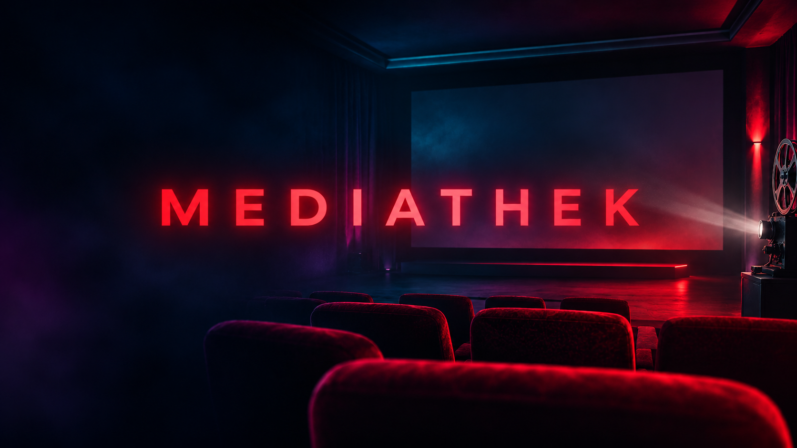
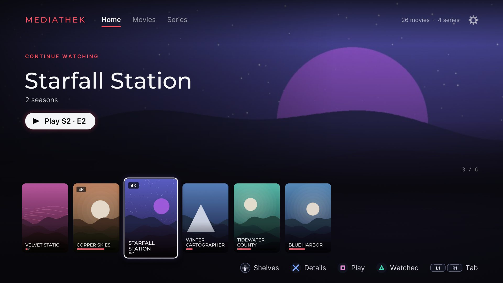
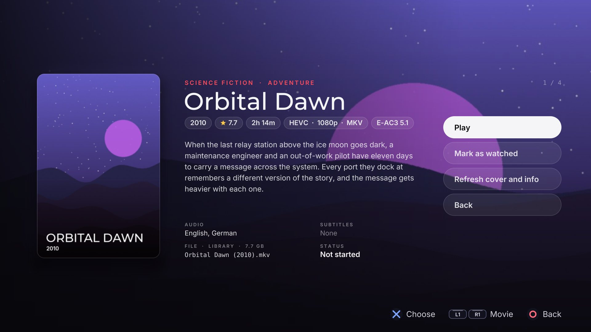
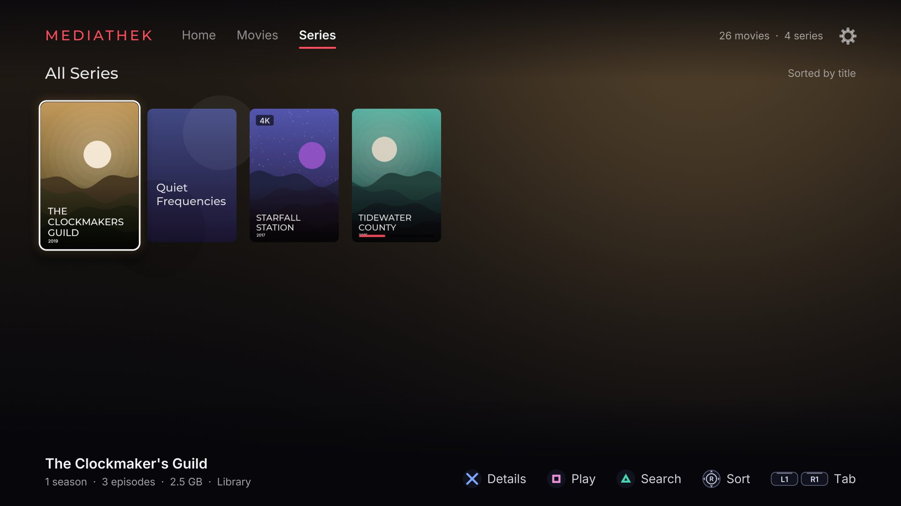
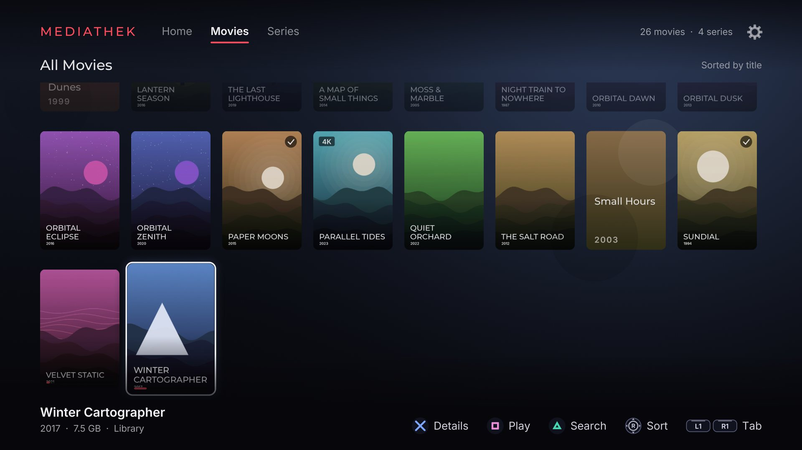
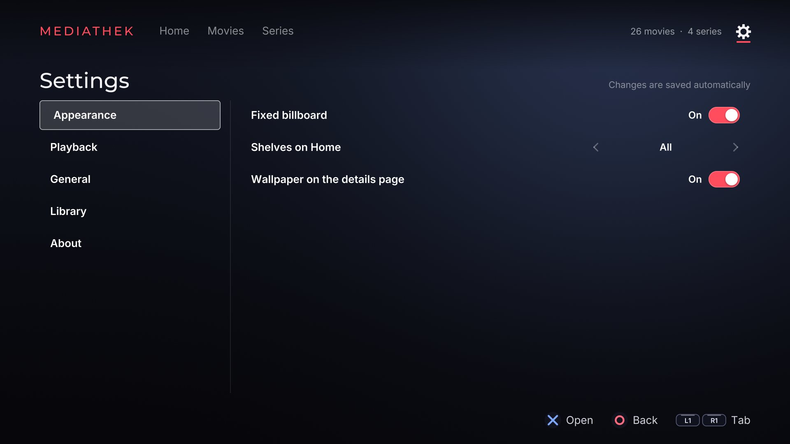

<p align="center"></p>

<div align="center">

---

**A Netflix-style library for your movies and series on PS5.**<br>
Put your films in a `movies` folder and your series in `tvshows`. Mediathek finds them, fetches their posters and plays them.

[](CHANGELOG.md)
[](#install)
[](docs/STATUS.md)
[](docs/SETTINGS.md#language)
[](LICENSE)
[](https://github.com/M0S4YSH3LL0/mediathek-ps5/releases)

[](https://prosperostore.net/app/PPSA66120/)
[](https://recompstore.com/game/PPSA66120)

</div>



## Features

- **Finds your films and series** on the internal drive, USB and extended storage, and reads messy file names.
- **Home, Movies and Series:** a billboard, shelves for *Continue Watching*, *Recently Added*, collections and genres, a grid with search and sorting.
- **Covers and descriptions** from TMDB with a free key; your own pictures always win.
- **Player:** hardware decoding for H.264 and HEVC up to 4K, HDR10 output, 5.1 sound, embedded and `.srt` subtitles, resume where you stopped, the next episode.
- **English and German.**

## Install

You need a PS5 that runs homebrew, with an **ELF loader on `127.0.0.1:9021`** (etaHEN and
compatible loaders have one). Without it the app starts but finds no films.

**From a store:** [ProsperoStore](https://prosperostore.net/app/PPSA66120/) or
[RecompStore](https://recompstore.com/game/PPSA66120).

**By hand:** unpack `Mediathek-PPSA66120-<version>.zip` from [Releases](../../releases)
(check it against its `.sha256`), copy the `PPSA66120` folder to `/data/homebrew/` and wait
about ten seconds until it appears on the home screen.

## Quick start

1. Put films in a `movies` folder and series in `tvshows` (one folder per series) on any drive:

   ```
   /data/movies/Blue Harbor (2011)/Blue Harbor (2011).mkv
   /mnt/usb0/tvshows/Tidewater County/Season 1/Tidewater.County.S01E01.mkv
   ```

2. For covers, create `/data/homebrew/PPSA66120/mediathek.env` with a free
   [TMDB key](https://www.themoviedb.org/settings/api):

   ```
   TMDB_API_KEY=your-key-here
   ```

3. Start Mediathek. Press **Options** to scan again.

## Documentation

- [Your library](docs/LIBRARY.md): folders, series, pictures, subtitles
- [Playback and controls](docs/PLAYBACK.md): formats, HDR, the buttons
- [Settings, covers and language](docs/SETTINGS.md)
- [FAQ](docs/FAQ.md)
- [What has been tested](docs/STATUS.md)
- [Building from source](docs/BUILD.md) and [changes](CHANGELOG.md)

## Screenshots

| | |
| --- | --- |
|  |  |
|  |  |

*Pictures from the PC preview, with invented films and series.*

## Status

Version 1.1.0, tested on firmware 12.70. Details in [docs/STATUS.md](docs/STATUS.md).

## Credits

Built on [ps5-homebrew-ui](https://github.com/blackbearreloaded/ps5-homebrew-ui),
[ps5-opengl](https://github.com/blackbearreloaded/ps5-opengl) and the
[PS5 Native App Boilerplate](https://github.com/blackbearreloaded/ps5-native-app-boilerplate)
by BlackBearReloaded, with sound effects from
[ProsperoPuzzles](https://github.com/blackbearreloaded/ProsperoPuzzles);
[Mesa](https://mesa3d.org/), the [PS5 Payload SDK](https://github.com/ps5-payload-dev/sdk),
[FFmpeg](https://ffmpeg.org/) (PacBrew's build), [dav1d](https://code.videolan.org/videolan/dav1d),
[The Movie Database](https://www.themoviedb.org/), and the fonts
[Inter](https://github.com/rsms/inter), [Montserrat](https://github.com/JulietaUla/Montserrat),
[DejaVu](https://dejavu-fonts.github.io/), [Press Start 2P](https://fonts.google.com/specimen/Press+Start+2P),
[Patrick Hand](https://fonts.google.com/specimen/Patrick+Hand) and [stb](https://github.com/nothings/stb).
Thanks to the PS5 homebrew community and the authors of etaHEN and compatible loaders.

*This product uses the TMDB API but is not endorsed or certified by TMDB.*

## Licence

GPL-3.0-or-later, see [LICENSE](LICENSE) and [THIRD_PARTY_NOTICES.md](THIRD_PARTY_NOTICES.md).
Mediathek plays files you provide and contains no films. It is not affiliated with Sony, TMDB
or anyone whose film you play. All films and brands in the screenshots are invented.
