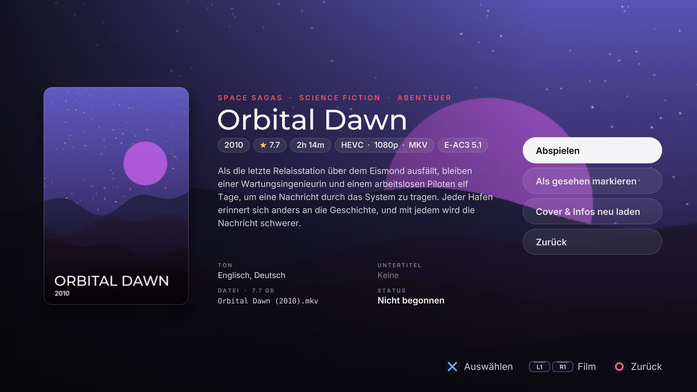

# Mediathek

[](CHANGELOG.md)
[](#status)
[](LICENSE)
[](#what-you-need)
[](#build-from-source)
[](#build-from-source)
[](#language)
[](#covers-wallpapers-and-descriptions)

**A Netflix-style movie library for the PS5.** Put your films in a folder called
`movies` on the internal drive, a USB stick or extended storage; Mediathek finds
them, shows a billboard and shelves with their posters, and plays them. It
speaks English and German.


| | |
| --- | --- |
|  |  |
|  |  |
|  |  |

*The pictures come from the PC preview with invented films; the covers and
wallpapers on a console are the real ones, fetched by the app. The last row
is the German interface.*

It is a native app (C++20, OpenGL 4.6) built on the
[ps5-homebrew-ui](https://github.com/blackbearreloaded/ps5-homebrew-ui) kit:
one shader draws everything, springs move everything, and the focus, sound and
glass behave like the console's own software.

## What it does

- **Home**: a billboard for the focused movie (its wallpaper if there is one,
  the poster otherwise) whose colour tints the whole page, then shelves:
  *Continue Watching*, *Recently Added*, one per collection (a subfolder with
  two or more movies), one per TMDB genre (every film is on the shelves of the two
  genres its details page names, and only those, so every genre you see there has a
  shelf here, the fullest first) and per decade, and *All Movies* (*Your Movies*
  in a small library). A red line above the title names the shelf the film is on.
- **Movies**: an eight-column grid, sortable by title, newest or year (R3), with a
  search (Triangle): an on-screen keyboard; every word you type must be in the
  title, and accents and case do not matter. Back clears the search first.
- **Details**: a full-screen page for the film: its wallpaper behind, the cover
  on the left, then title and genres, chips for the year, TMDB's user score,
  length, video format (codec, resolution, container) and sound format, a
  description (from TMDB), the languages of the sound and of the subtitles, the
  file with its size, and where you stopped; Play / Resume, Start over, Mark as
  watched and Refresh cover and info on the right. L1/R1 or left/right step to
  the previous or next film of the shelf (or the grid) you came from, without
  going back.
- **Player**: scrubber, seek ±10 s (hold: ±30 s, L1/R1 or L2/R2: ±60 s), pause,
  audio track switching (Square) and `.srt` subtitle switching (Triangle; with
  several subtitle files it steps through them and then off), a stream info panel. It remembers
  where you stopped and resumes there; 92% counts as watched.
- **Covers and wallpapers by themselves**: with a free TMDB key the app fetches
  a poster and a wallpaper for every film that has none (see below).
- **English and German**: the app follows the console's language setting and
  falls back to English (see *Language*).
- **Names are read for you**: `Blue Harbor (2011).mkv`,
  `blue.harbor.2011.2160p.BluRay.x265-GRP.mkv`, `1917 (2019).mp4` all work.

## What you need

- A PS5 that runs homebrew, with a loader that starts apps from
  `/data/homebrew` and an **ELF loader listening on `127.0.0.1:9021`** (etaHEN
  and compatible loaders do). Mediathek cannot list folders from inside the
  sandbox, so it sends a small helper payload to that loader (see *How it finds
  your files*). Without it the app starts, but finds no films.
- Films on the console's internal drive or on a USB or extended drive, in a
  folder called `movies` (or `Movies`).
- Optional, for covers: a free [TMDB](https://www.themoviedb.org/settings/api)
  key and a network connection.

This repository does not configure a console. Set up your loader the way its own
documentation says.

## Install

1. Download `Mediathek-PPSA66120-<version>.zip` from the
   [Releases](../../releases) page (check it against the `.sha256` file next to
   it) and unpack it. You get a folder called `PPSA66120`.
2. Copy that folder to `/data/homebrew/` on the console (FTP, or whatever your
   loader offers). The result is `/data/homebrew/PPSA66120/eboot.bin`.
3. Wait about ten seconds after the copy ends: the console registers a new title
   a moment after its folder stops changing. Mediathek then appears on the home
   screen.
4. Start it. On the first start it scans for films, which takes a moment; the
   library appears when the scan is done, and from then on it appears at once.
   Press **Options** to scan again.

Updating: copy the new folder over the old one. If the home screen shows an old
icon or an app that will not start after a change, delete the title first
(`/data/homebrew/PPSA66120`, and the console's copies under `/user/app/PPSA66120`
and `/user/appmeta/PPSA66120`) and copy it again.

## Language

The app is in English or German. It reads the console's language setting
(German on a German console, English for everything else) and uses it. To pick
one yourself, add a line to `mediathek.env` in the install folder:

```
UI_LANGUAGE=de
```

`en`, `de` or `auto` (the default: ask the console). The TMDB description and
fetched titles come in the same language unless `TMDB_LANGUAGE` says otherwise.
Another language is one more column in `src/core/i18n_texts.inc`.

## Your files

Put films anywhere below a `movies` folder, up to six levels deep:

```
/data/movies/Blue Harbor (2011)/Blue Harbor (2011).mkv
/mnt/usb0/movies/Space Sagas/Orbital Dawn (2010).mkv
```

- The folders searched are `/data/movies`, `/movies`, `/mnt/usb0-7/movies` and
  `/mnt/ext0-1/movies` (`Movies` too). A drive that ignores letter case lists
  `movies` and `Movies` as one folder; it is scanned once.
- A film's folder can hold its pictures: `<film>-poster.jpg` and
  `<film>-fanart.jpg` (a folder that holds a single film may use `poster.jpg`,
  `folder.jpg`, `cover.jpg` and `fanart.jpg`, `backdrop.jpg` instead). Pictures
  you provide always win over fetched ones.
- Subtitles are `.srt` files with the film's name, beside it or in a `subs`
  folder next to it; a film alone in its folder owns everything in `subs`.
  English comes first (`.en`, `english`, `eng`), then the others in the order
  found (up to eight); the first one shows when the film starts. Embedded
  subtitle tracks are not shown.
- A film without a picture gets a generated cover.

## Controls

| | Browse | Details | Player |
| --- | --- | --- | --- |
| D-pad / stick | move | up/down: action; left/right: previous / next film | left/right: seek |
| Cross | details | choose | pause / play |
| Square | play (resumes) | | next audio track |
| Triangle | watched (Home) / search (Movies) | | next subtitles, then off |
| R3 (press the right stick) | sort (Movies) | | |
| Options | scan again | | stream info |
| L1 / R1 | Home / Movies | previous / next film | seek -60 s / +60 s |
| Circle | back: Movies to Home, to the first film, then press twice to exit | back | stop |

## Covers, wallpapers and descriptions

A film without artwork gets a generated cover. The app can fetch the real
poster, a wide wallpaper (the picture behind the selected film) and the
description shown on the details page from The Movie Database by itself, but
only for a film that has no cover yet (the score and genres, kept since 0.3.0,
are also fetched once for a film that has a cover). A picture beside the film is never
replaced, and a film that already has a cover is not asked about again.

1. Get a free key for personal use at themoviedb.org/settings/api.
2. Create a text file `mediathek.env` in `/data/homebrew/PPSA66120/` on the
   console with your key:

   ```
   TMDB_API_KEY=your-key-here
   TMDB_LANGUAGE=en-US
   ```

   `TMDB_LANGUAGE` is optional; it follows the app's language (`en-US` or
   `de-DE`) when left out. If your network blocks
   public DNS, add `DNS_SERVER=192.168.0.1` with your router's address. When you
   build from source, `make` writes this file for you from the project's `.env`
   (never into the `.zip`; the key is yours, keep it out of anything you share).
3. Start the app. After every scan it asks for the films that have no cover,
   one at a time in the background, and each new picture appears within a
   couple of seconds. Films that already have a cover (yours, or one fetched
   before) and films TMDB does not know are not asked again. In a film's
   details, **Refresh cover and info** downloads the pictures and the
   description anew. The description comes in
   `TMDB_LANGUAGE`; where TMDB has none in that language, the page says so.

The fetched pictures, descriptions, scores and genres are kept in the app's save
area (`/download0/hui/covers`). The *score* is TMDB's user score out of 10, not a
critics' score, and it is left out for a film with no votes. What the file itself
holds (length, codecs, audio and subtitle languages) is read from the file when you
open its details and kept in `/download0/hui/info`; **Refresh cover and info** reads
it again. Only what can be used is listed: the audio tracks the app can decode, and the
`.srt` beside the film (its language comes from the file name, `Film.de.srt`); subtitle
tracks inside the file are not shown by the player, so they are not listed.
The connection is checked against the certificate bundle in `assets/certs`. A
PC can do the same job with `python3 tools/fetch-posters.py /path/to/movies`
(`--dry-run` lists what is missing). This product uses the TMDB API but is not
endorsed or certified by TMDB.

## How it finds your files

A sandboxed PS5 title can open a file it knows the path of, but cannot list a
folder. Mediathek therefore sends a small helper payload (`helper/mt-scan.c`,
built into the app as `assets/helper/mt-scan.elf`) to the ELF loader on
`127.0.0.1:9021`. The helper walks the folders above, copies the small pictures
and subtitles into the install folder, and writes `mediathek-index.txt` next to
the app, which the app reads as `/app0/mediathek-index.txt`. The last index is
read at start-up, so the library appears at once.

## Video

Movies are decoded in software by PacBrew's FFmpeg, on the CPU. A large 1080p
H.264 MKV plays smoothly on the author's console. 4K, HEVC (especially 10-bit)
and HDR are **not** expected to be smooth, and HDR is not tone-mapped. The app
sizes its memory to what the console grants (up to 384 MiB); a busy 1080p film
needs well over the 128 MiB the kit started with. Pausing and resuming
re-seeks, so resuming takes a moment on a slow drive.

## Build from source

```bash
make                  # the PS5 app folder in dist/PPSA66120 (needs the toolchain make fetches)
tools/host-snapshots.sh build/snapshots mediathek   # PC preview: PNG pictures of every screen
HUI_LANG=de tools/host-snapshots.sh build/snapshots-de mediathek   # ... in German
python3 tools/make-sample-movies.py                 # the invented films the preview shows
make test-unit        # GoogleTest, sanitizers on
make format-check
make lint             # needs a git index; AGENTS.md says how to give it one
```

Copy `.env.example` to `.env` for your console's address (`make deploy`) and, if
you like, your TMDB key. The PC preview renders the same UI code with Mesa; it
plays no video (a simulated player draws a moving test picture) and makes no
sound. [AGENTS.md](AGENTS.md) and [CONTRIBUTING.md](CONTRIBUTING.md) describe
the code and the rules for changes; a release tag is the exact
`contentVersion` of `sce_sys/param.json`.

## Status

Version 0.4.0 (`contentVersion` 01.000.040).

**Checked on the author's console (firmware 12.70):** the app starts, the scan
finds the films, covers, wallpapers and descriptions download, the details page
shows them with the film's length, formats, score, genres and the audio and
subtitle languages, and a large 1080p H.264 MKV plays with sound without
glitches. Stepping between films on the details page, the red shelf line,
stepping through several subtitle files, the genre shelves on Home, the search
on the Movies page and sorting with R3 work too. The console's language detection (German console, German texts), the
load time of the larger fonts, subtitle and audio-track switching, the staged
Back/exit, sound in the menus and the controller feedback all work, with films
on the internal drive and on an external drive. The loader version was not
recorded; reports for other firmware versions are welcome.

**Not checked on a console yet:** 4K and HEVC playback. The unit tests, the PC
preview pictures, the scan helper against a folder of sample files and a clean
build and lint run on a PC.

## Credits

Mediathek stands on other people's work:

- [ps5-homebrew-ui](https://github.com/blackbearreloaded/ps5-homebrew-ui) by
  BlackBearReloaded: the renderer, motion, themes, mixer and build this app is
  made from, with the sound effects from
  [ProsperoPuzzles](https://github.com/blackbearreloaded/ProsperoPuzzles).
- [ps5-opengl](https://github.com/blackbearreloaded/ps5-opengl) and
  [Mesa](https://mesa3d.org/): OpenGL 4.6 on the PS5.
- The [PS5 Payload SDK](https://github.com/ps5-payload-dev/sdk) and
  [PS5 Native App Boilerplate](https://github.com/blackbearreloaded/ps5-native-app-boilerplate):
  the toolchain and native foundation.
- [FFmpeg](https://ffmpeg.org/), in PacBrew's build: it decodes the films.
- [The Movie Database](https://www.themoviedb.org/): posters, wallpapers and
  descriptions. This product uses the TMDB API but is not endorsed or certified
  by TMDB.
- The PS5 homebrew community and the authors of the loaders (etaHEN and
  compatible) that make running unsigned apps and the scan helper possible.
- [Inter](https://github.com/rsms/inter),
  [Montserrat](https://github.com/JulietaUla/Montserrat),
  [DejaVu](https://dejavu-fonts.github.io/),
  [Press Start 2P](https://fonts.google.com/specimen/Press+Start+2P),
  [Patrick Hand](https://fonts.google.com/specimen/Patrick+Hand) and
  [stb](https://github.com/nothings/stb).

Every third-party component, with its licence, is listed in
[THIRD_PARTY_NOTICES.md](THIRD_PARTY_NOTICES.md).

## Legal

Mediathek plays files you provide; it contains no films, and no film data
ships with it. Use your own legally obtained copies. It is not affiliated with
Sony, TMDB or anyone whose film you play. All films and brands in the
screenshots are invented.

## Licence

GPL-3.0-or-later (see `LICENSE`). Third-party components, including FFmpeg and
the libraries linked with it, TMDB's API and the Mozilla CA bundle, are listed
in `THIRD_PARTY_NOTICES.md`.
