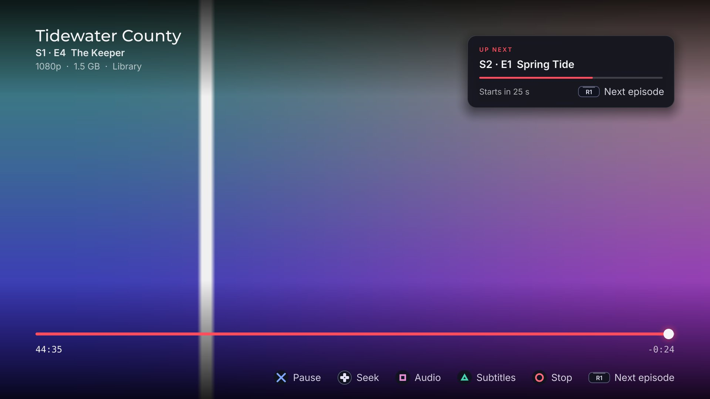

# Your library

Where Mediathek looks for films and series, how it names them, and where their pictures and
subtitles go.

## Films

Put films anywhere below a `movies` or `mediathek/movies` folder (`Movies` works too), up to
six levels deep:

```
/data/movies/Blue Harbor (2011)/Blue Harbor (2011).mkv
/mnt/usb0/mediathek/movies/Space Sagas/Orbital Dawn (2010).mkv
```

It searches `movies` and `mediathek/movies`, and the [series folders](#series), on `/data`,
`/`, `/mnt/usb0-7` and `/mnt/ext0-1`. Press **Options** to scan again.

Messy names are read too: `blue.harbor.2011.2160p.BluRay.x265-GRP.mkv` is
*Blue Harbor (2011)*.

- **Collections:** a subfolder with two or more films becomes its own shelf.
- **Pictures:** `<film>-poster.jpg` and `<film>-fanart.jpg` beside the film. A film
  alone in its folder can also use `poster.jpg`, `folder.jpg` or `cover.jpg`, and
  `fanart.jpg` or `backdrop.jpg`. Your own pictures always win over fetched ones.
- **Audio language:** if a file does not say, its name can: `Film (2011) German DL.mkv`
  is listed as German.

## Other folders

Films or series somewhere else? Add the folder in **Settings > Library > Add folder**: a full
path such as `/mnt/usb0/Media`, or just a name such as `Media`, which is then looked for on
every drive. Up to eight. Left and right on a folder choose what it holds:

- **Automatic** (the default): a `series`, `Serien`, `tvshows` or `TV Shows` folder anywhere
  inside it holds series, one folder per series; a file with an episode mark is an episode;
  everything else is a film.
- **Movies:** every video in it is a film, episode marks or not.
- **Series:** every video in it is an episode, and the first folder below it is the series,
  as in `tvshows`.

Choose a folder to remove it. Cross on the "No media found" screen goes straight there.

## Series

Put series in a `tvshows` or `series` folder (also `TV Shows`, `mediathek/tvshows` and
`mediathek/series`), one folder per series, with season folders inside or not:

```
/data/tvshows/Tidewater County/Season 1/Tidewater.County.S01E01.mkv
/mnt/usb0/series/Starfall Station/season2/Starfall Station - 2x03 - Ballast.mkv
```

- **Episodes:** the name gives the season and the episode: `S01E02`, `s1e2`, `1x02` or
  `S01 E02`. Without one, a season folder (`Season 1`, `Season1`, `season 01`, `Staffel 1`,
  `S01`, `Specials`) gives the season and a number in the name (`E05`, `Episode 5`,
  `05 - Title`) the episode.
- **Anywhere else:** a file whose name has such a mark is an episode in any searched folder,
  of the series its folder is named after (or the name before the mark).
- **Pictures:** `poster.jpg` and `fanart.jpg` in the series' folder.
- **Watched:** Triangle on Home marks a whole series watched, or unwatched again; an episode
  is marked on its own on the details page.
- **Up next:** in the player, R1 starts the next episode, and in an episode's last 40 seconds
  a card counts down to it; L1 starts the episode again, and L1 twice in a row the one before.



## Subtitles

- **Where they come from:** the tracks inside the film (text: SubRip, ASS, mov_text,
  WebVTT; pictures: PGS, VobSub, DVB), and `.srt` files named after the film, beside it or
  in a `subs` folder (a film alone in its folder owns all of `subs`; up to eight). A file's
  language comes from the name (`Film.de.srt`, `English.srt`) or else from the words inside.
- **Switching:** a film starts without subtitles unless *Force subtitles* is on; Triangle
  switches them on and steps through them all, the preferred language first, and in it
  the film's own tracks before the files. Its message says which: "German · embedded",
  "German · SRT", "English · SDH · embedded".
- **Forced subtitles:** a forced track holds only the lines in another language than the
  film's: a sign, a scene abroad. While no full subtitles are on, it shows by itself, in the
  *Subtitle language*, or with None in the language of the sound track playing (it follows
  Square). The film's own forced track comes before a file (`Film.de.forced.srt`). Triangle
  does not offer forced tracks: switching full subtitles off brings them back.

## How it finds your files

A sandboxed PS5 title can open a file by its path but cannot list a folder. So
Mediathek sends a small helper (`helper/mt-scan.c`) to the ELF loader on `127.0.0.1:9021`.
The helper walks the folders, copies small pictures and subtitles next to the app and writes
`mediathek-index.txt`. The app reads the last index at start-up, which is why the library
opens at once.

Covers, descriptions and file facts live in `/download0/hui` and survive a rescan, as
does the day each film and episode was first found (`added.txt`), which is what
*Recently Added* goes by: a copied file often keeps its old modification time.
